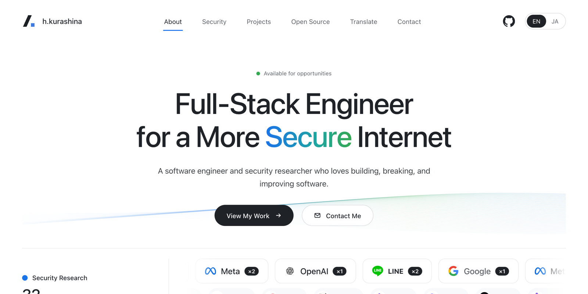

  

<h3 align="center">Full-stack engineer and security researcher.</h3>

  Vulnerability research, penetration testing, Rust tools and open source — 
  everything is on my portfolio.

  

  <a href="https://hina-kura49.github.io/portfolio/ja/">日本語</a> ·
  <a href="mailto:h.kurashina49@gmail.com">h.kurashina49@gmail.com</a> ·
  <a href="https://x.com/hkurashina49">X @hkurashina49</a>

