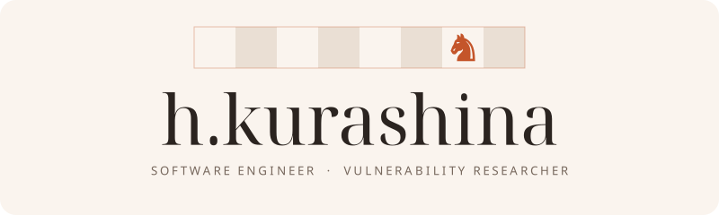

  <picture>
    <source media="(prefers-color-scheme: dark)" srcset="assets/logo-dark.svg">
    
  </picture>

  

  
  
  

## Hi! I'm h.kurashina

Software Engineer / Vulnerability Researcher / Business Lead.
I lead a startup's product, **Beaulab**, as both engineer and business owner,
and I spend the rest of my time on **Rust, open source and security research**.

- 🦀 Contributor to the Rust compiler and Clippy; member of Rust Developer JP and rust-jp
- 🔐 Vulnerability researcher: I find issues in open-source software, report them to the maintainers and help get fixes published
- 🪟 Currently building [**liwin**](https://github.com/hina-kura49/liwin), an AeroSpace-like tiling window manager for GNOME on Wayland
- 🔭 Interested in AI & web security testing, low-level systems, infrastructure and competitive programming
- ♟️ Off the keyboard: chess and Hack The Box

## Open source

| Contribution | Where |
|---|---|
| Don't build format string suggestions from `concat!` offsets (fixes an ICE) | [rust-lang/rust#163368](https://github.com/rust-lang/rust/pull/163368) |
| Don't suggest replacing foreign format specifiers in `concat!` output | [rust-lang/rust#163371](https://github.com/rust-lang/rust/pull/163371) |
| Avoid cloning cached test item names in `is_in_test` | [rust-lang/rust-clippy#17774](https://github.com/rust-lang/rust-clippy/pull/17774) |
| Output test binary to the temporary directory in `test-expand.sh` | [rust-lang/ac-library-rs#183](https://github.com/rust-lang/ac-library-rs/pull/183) |
| Reported a missing safety condition in the `Searcher` contract that `str::split` relies on; fixed by another contributor in rust-lang/rust#165681 | [rust-lang/rust#164904](https://github.com/rust-lang/rust/issues/164904) |

## Security research

| CVE | Project | Severity |
|---|---|---|
| [CVE-2026-45405](https://github.com/dokku/dokku/security/advisories/GHSA-j6qq-xg73-ghqg) | Dokku: arbitrary file write via tar symlinks | Critical |
| [CVE-2026-42461](https://github.com/getarcaneapp/arcane/security/advisories/GHSA-cxx3-hr75-4q96) | Arcane: unauthenticated leak of Compose templates and `.env` | High |
| [CVE-2026-43917](https://github.com/Dokploy/dokploy/security/advisories/GHSA-f8wj-5c4w-frhg) | Dokploy: missing cross-organization authorization check (IDOR) | Medium |

Certified hacker by the Japan Hacker Association. Experience with web penetration testing using Burp Suite.

## Projects

| Project | What it is | Tech |
|---|---|---|
| [Beaulab](https://beaulab.jp) | Social platform for beauty clinics: discover clinics through reviews and posts, then book and message them | Next.js, React Native / Expo |
| [liwin](https://github.com/hina-kura49/liwin) | AeroSpace-like tiling for GNOME on Wayland: a Rust daemon plus a thin GNOME Shell extension | Rust, TypeScript |
| [git-trail](https://github.com/h-kurashina/git-trail) | Local CLI that reconstructs the history of a Git worktree as timestamped checkpoints; `cargo install git-trail` | Rust |
| [kura-rs](https://kura-tau.vercel.app) | Copy-paste Rust components with evidence: AI data processing and security building blocks, each with differential tests and benchmarks | Rust, TypeScript |
| [SortedMultiset for Rust](https://github.com/h-kurashina/sorted-multiset-rs) | Sorted multiset for competitive programming; std only, no `unsafe`, about 10–13× faster than the Python original | Rust |
| [Tadori](https://github.com/h-kurashina/tadori) | Learning-roadmap app that links technical and business books by order and outcomes | Expo, React Native |
| Wryte | Technical writing and knowledge-sharing service | React, FastAPI, PostgreSQL |
| [sta.](https://github.com/h-kurashina/sta.) | Document scanner for students that files scans straight into subjects | SwiftUI, VisionKit |

## Tech

  

## Stats

  
  

<picture>
  <source media="(prefers-color-scheme: dark)" srcset="https://raw.githubusercontent.com/hina-kura49/hina-kura49/output/github-snake-dark.svg">
  
</picture>
