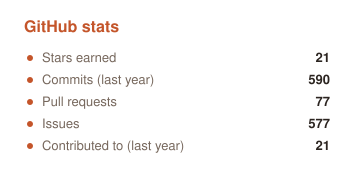

  <picture>
    <source media="(prefers-color-scheme: dark)" srcset="assets/banner-dark.png">
    
  </picture>

  <picture>
    <source media="(prefers-color-scheme: dark)" srcset="https://raw.githubusercontent.com/hina-kura49/hina-kura49/output/github-snake-dark.svg">
    
  </picture>

  

  
  
  
  

## Hi! I'm h.kurashina

Rust engineer and **freelance white-hat hacker**. I contribute to the Rust compiler and the Rust ecosystem,
rewrite C libraries in Rust for memory safety, and report vulnerabilities privately to maintainers.
Certified hacker by the Japan Hacker Association. Off the keyboard: chess and reading.

📫 Work inquiries (security assessments, penetration testing): [h.kurashina49@gmail.com](mailto:h.kurashina49@gmail.com)

## 🚀 Projects

### 🪟 [liwin](https://github.com/hina-kura49/liwin)
AeroSpace-like tiling window manager for GNOME on Wayland: a Rust daemon plus a thin GNOME Shell extension. *Currently building.*

### 📝 [Jot](https://github.com/hina-kura49/jot)
macOS note-taking app that keeps notes as plain Markdown files: Notion-style block editing, slash commands, quick capture and Google Calendar sync.

### 🧭 [git-trail](https://github.com/hina-kura49/git-trail)
Local CLI that reconstructs the history of a Git worktree as timestamped checkpoints. `cargo install git-trail`

### 📦 [kura-rs](https://www.kura-rs.com/)
Copy-paste Rust components with evidence, each with differential tests and benchmarks. Includes [kura-rs/cjson](https://github.com/kura-rs/cjson), a hand-written Rust port of cJSON.

More projects

- [SortedMultiset for Rust](https://github.com/hina-kura49/sorted-multiset-rs): sorted multiset for competitive programming; std only, no `unsafe`, about 10–13× faster than the Python original
- [Tadori](https://github.com/hina-kura49/tadori): learning-roadmap app that links technical and business books by order and outcomes
- Wryte: technical writing and knowledge-sharing service
- [sta.](https://github.com/hina-kura49/sta.): document scanner for students that files scans straight into subjects

## 📊 Track record

| 🦀 Open source contributions | 🛡️ CVEs |
|:---:|:---:|
| **7** rust-lang/rust, rust-clippy, RustSec, ac-library-rs | **3** 1 Critical · 1 High · 1 Medium |

## Stats

  <picture>
    <source media="(prefers-color-scheme: dark)" srcset="https://raw.githubusercontent.com/hina-kura49/hina-kura49/output/stats/stats-dark.svg">
    
  </picture>
  <picture>
    <source media="(prefers-color-scheme: dark)" srcset="https://raw.githubusercontent.com/hina-kura49/hina-kura49/output/stats/top-langs-dark.svg">
    
  </picture>

