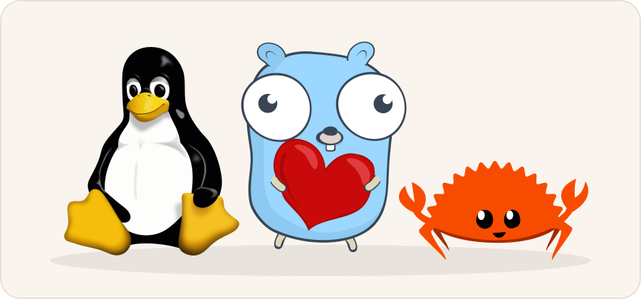
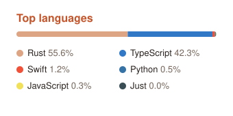

  <picture>
    <source media="(prefers-color-scheme: dark)" srcset="assets/banner-dark.png">
    
  </picture>

  <picture>
    <source media="(prefers-color-scheme: dark)" srcset="https://raw.githubusercontent.com/hina-kura49/hina-kura49/output/github-snake-dark.svg">
    
  </picture>

  

  
  
  
  

## Hi! I'm h.kurashina

Rust engineer and **freelance white-hat hacker**.
By day I build a startup's product as both engineer and business owner;
the rest of my time goes into **Rust, open source and responsible security research**.

- 🦀 Contributor to the Rust compiler (rustc)
- 🌱 Focusing on contributing to existing open source, including the Rust ecosystem and RustSec
- 🛡️ Rewriting C libraries in Rust for memory safety, as part of kura-rs: [kura-rs/cjson](https://github.com/kura-rs/cjson) is a hand-written Rust port of cJSON
- 🎩 White-hat hacker (freelance): I take on security assessments and penetration testing, and in open source I report vulnerabilities privately to the maintainers and help get fixes and advisories published
- 📫 Work inquiries: [h.kurashina49@gmail.com](mailto:h.kurashina49@gmail.com)
- 🪟 Currently building [**liwin**](https://github.com/hina-kura49/liwin), an AeroSpace-like tiling window manager for GNOME on Wayland
- 🔭 Interested in AI & web security testing, low-level systems, infrastructure and competitive programming
- ♟️ Off the keyboard: chess and reading

## Open source

| When | Contribution | Where | Status |
|---|---|---|---|
| 2026-11 | Reported four ways to cause undefined behavior from safe code in `yaxpeax-x86` (fixed upstream in 2.2.1) and filed a RustSec advisory | [rustsec/advisory-db#3578](https://github.com/rustsec/advisory-db/pull/3578) | In review |
| 2026-11 | Reported a missing safety condition in the `Searcher` contract that `str::split` relies on; fixed by another contributor in rust-lang/rust#165681 | [rust-lang/rust#164904](https://github.com/rust-lang/rust/issues/164904) | Resolved |
| 2026-10 | Don't suggest replacing foreign format specifiers in `concat!` output | [rust-lang/rust#163371](https://github.com/rust-lang/rust/pull/163371) | Merged |
| 2026-10 | Don't build format string suggestions from `concat!` offsets (fixes an ICE) | [rust-lang/rust#163368](https://github.com/rust-lang/rust/pull/163368) | Merged |
| 2026-10 | Add regression tests for #164253 | [rust-lang/rust#164910](https://github.com/rust-lang/rust/pull/164910) | Merged |
| 2026-09 | Output test binary to the temporary directory in `test-expand.sh` | [rust-lang-ja/ac-library-rs#183](https://github.com/rust-lang-ja/ac-library-rs/pull/183) | In review |
| 2026-09 | Avoid cloning cached test item names in `is_in_test` | [rust-lang/rust-clippy#17774](https://github.com/rust-lang/rust-clippy/pull/17774) | In review |

## Security research

| Published | CVE | Project | Severity |
|---|---|---|---|
| 2026-05 | [CVE-2026-45405](https://github.com/dokku/dokku/security/advisories/GHSA-j6qq-xg73-ghqg) | Dokku: arbitrary file write via tar symlinks | Critical |
| 2026-04 | [CVE-2026-42461](https://github.com/getarcaneapp/arcane/security/advisories/GHSA-cxx3-hr75-4q96) | Arcane: unauthenticated leak of Compose templates and `.env` | High |
| 2026-05 | [CVE-2026-43917](https://github.com/Dokploy/dokploy/security/advisories/GHSA-f8wj-5c4w-frhg) | Dokploy: missing cross-organization authorization check (IDOR) | Medium |

Certified hacker by the Japan Hacker Association. Experience with web penetration testing using Burp Suite.

## Projects

| Project | What it is | Tech |
|---|---|---|
| [liwin](https://github.com/hina-kura49/liwin) | AeroSpace-like tiling for GNOME on Wayland: a Rust daemon plus a thin GNOME Shell extension | Rust, TypeScript |
| [Jot](https://github.com/hina-kura49/jot) | macOS note-taking app that keeps notes as plain Markdown files in a vault folder: Notion-style block editing, slash commands, quick capture and Google Calendar sync | Tauri 2, Rust, TypeScript |
| [git-trail](https://github.com/hina-kura49/git-trail) | Local CLI that reconstructs the history of a Git worktree as timestamped checkpoints; `cargo install git-trail` | Rust |
| [kura-rs](https://www.kura-rs.com/) | Copy-paste Rust components with evidence: AI data processing and security building blocks, each with differential tests and benchmarks. Also rewriting C libraries in Rust for memory safety, starting with [kura-rs/cjson](https://github.com/kura-rs/cjson), a hand-written Rust port of cJSON | Rust, TypeScript |
| [SortedMultiset for Rust](https://github.com/hina-kura49/sorted-multiset-rs) | Sorted multiset for competitive programming; std only, no `unsafe`, about 10–13× faster than the Python original | Rust |
| [Tadori](https://github.com/hina-kura49/tadori) | Learning-roadmap app that links technical and business books by order and outcomes | Expo, React Native |
| Wryte | Technical writing and knowledge-sharing service | React, FastAPI, PostgreSQL |
| [sta.](https://github.com/hina-kura49/sta.) | Document scanner for students that files scans straight into subjects | SwiftUI, VisionKit |

## Tech

  

  <picture>
    <source media="(prefers-color-scheme: dark)" srcset="assets/mascots-dark.svg">
    
  </picture>
   
  
    Tux by Larry Ewing (lewing@isc.tamu.edu) and The GIMP, vector by Garrett LeSage and IFo Hancroft (CC0) ·
    Go Gopher designed by Renée French, <a href="https://creativecommons.org/licenses/by/4.0/">CC BY 4.0</a>, vector by Egon Elbre (CC0) ·
    Ferris by Karen Rustad Tölva (CC0) ·
    arranged into one image for this profile; see <a href="assets/LICENSES.md">assets/LICENSES.md</a>
  

## Stats

  <picture>
    <source media="(prefers-color-scheme: dark)" srcset="https://raw.githubusercontent.com/hina-kura49/hina-kura49/output/stats/stats-dark.svg">
    
  </picture>
  <picture>
    <source media="(prefers-color-scheme: dark)" srcset="https://raw.githubusercontent.com/hina-kura49/hina-kura49/output/stats/top-langs-dark.svg">
    
  </picture>

